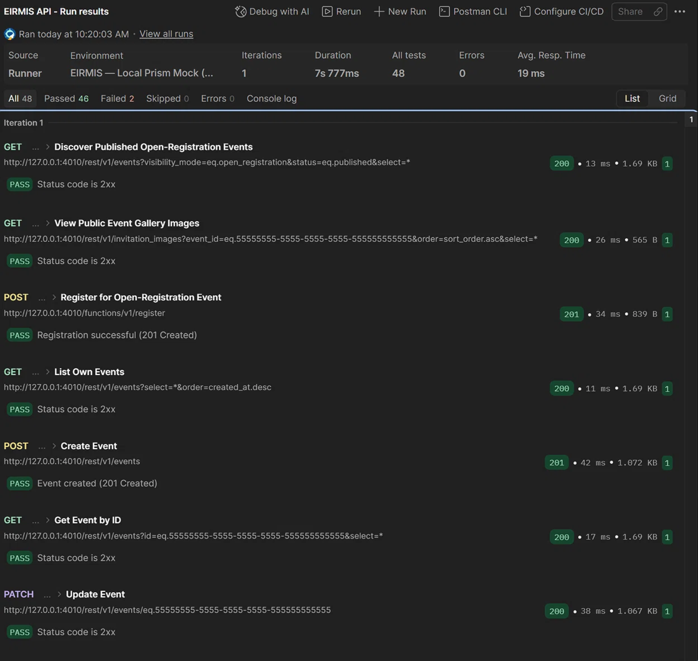
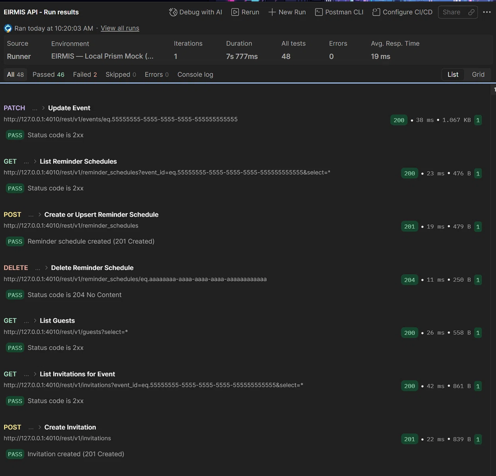
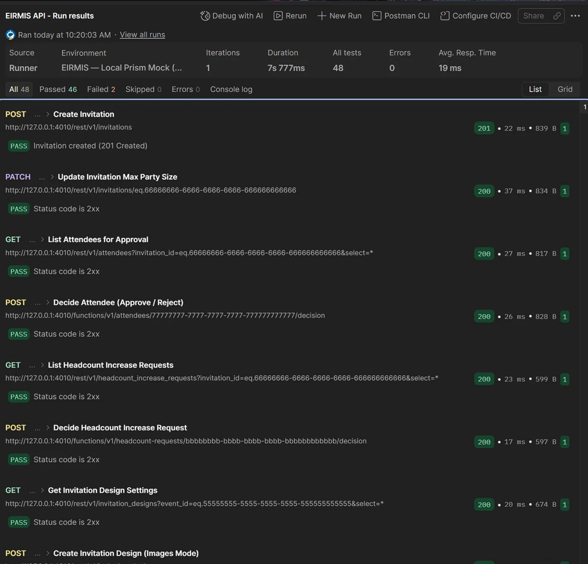
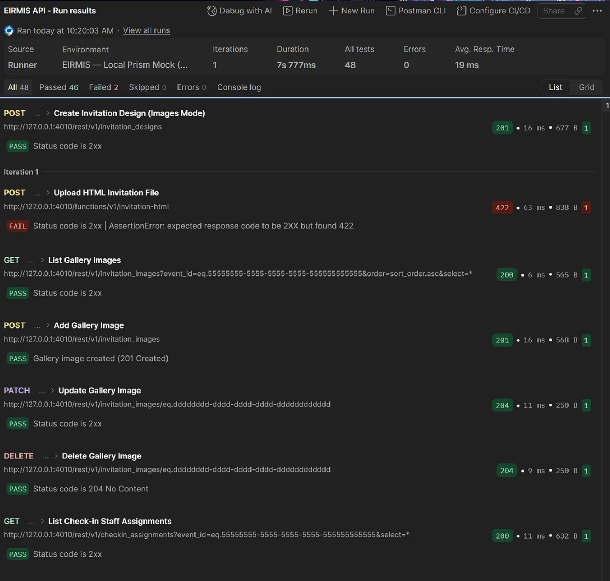
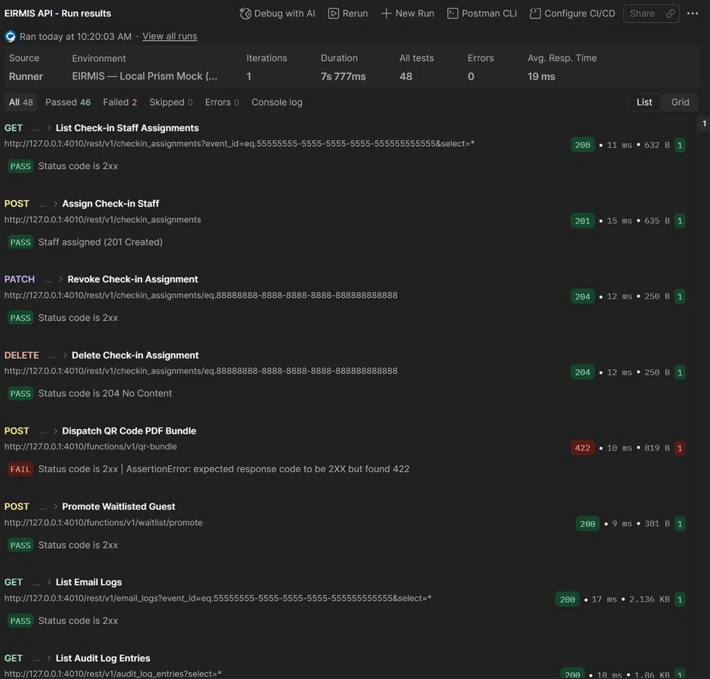
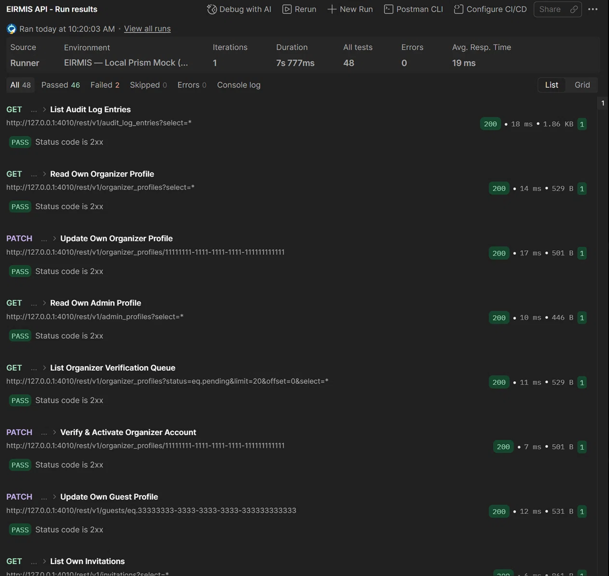
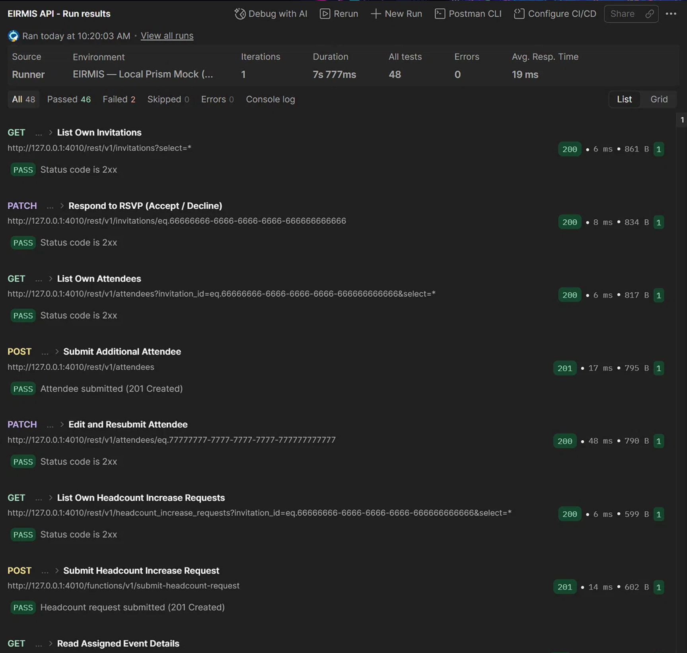
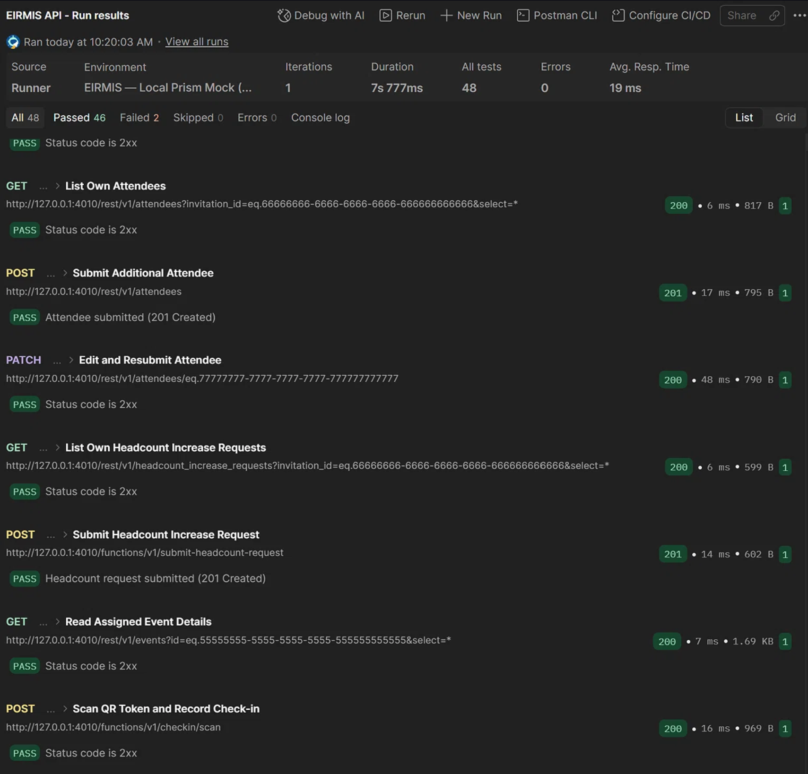
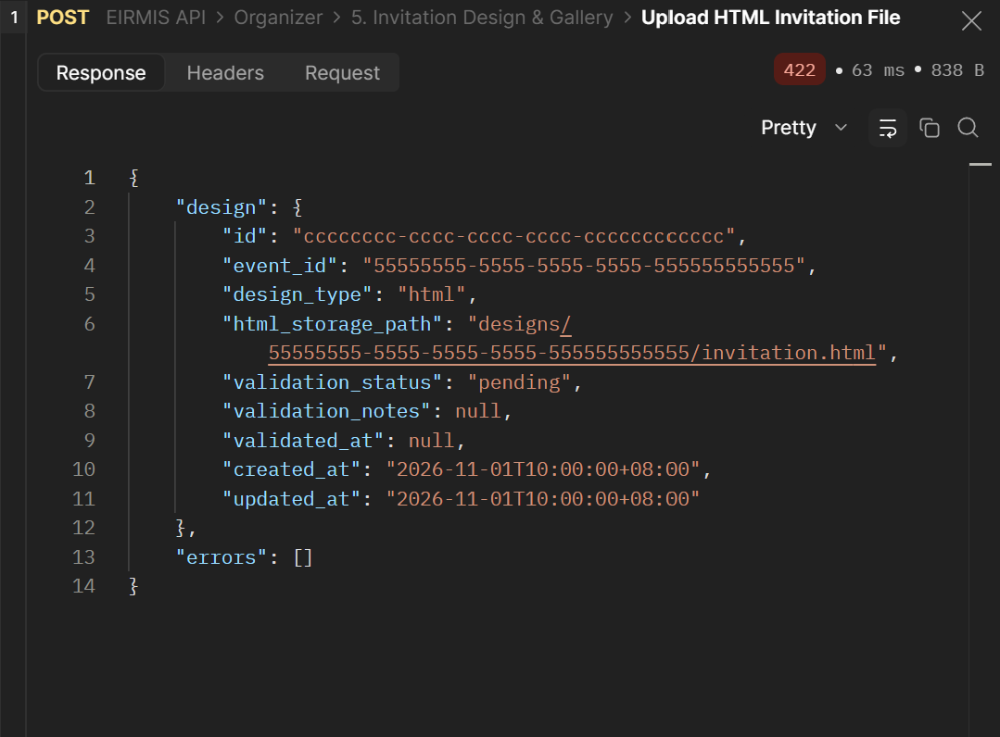
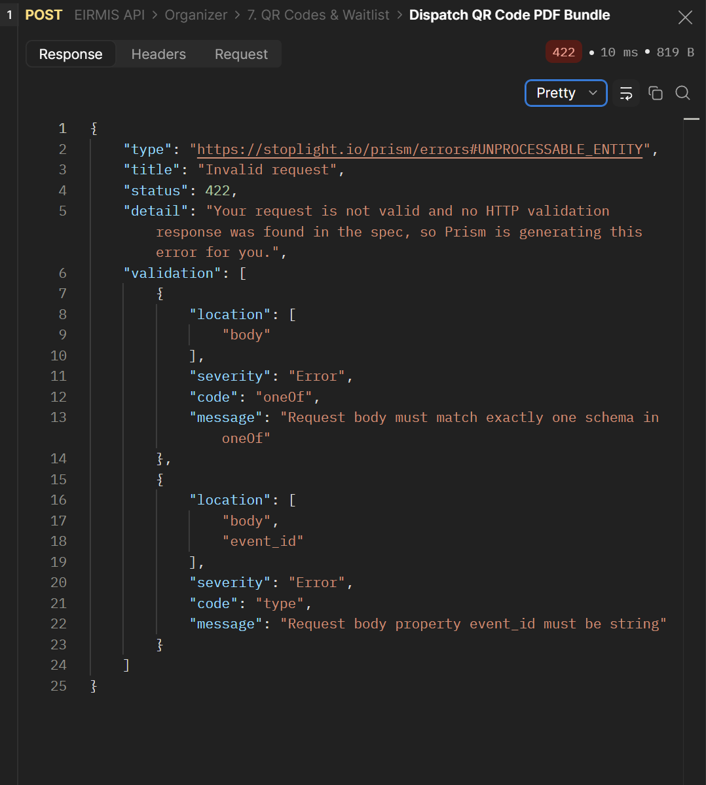

# QA Test Run Report: EIRMIS API - Local Prism Mock Smoke Run

- **Date & Time:** 2026-10-31 10:20:03 AM (Local Time)
- **QA Engineer:** Jess Cormanes
- **Git Commit / Branch:** chore/open-api-contract-mockup-enhancement
- **Target Environment:** 
  - [x] Stoplight Prism Mock (`http://127.0.0.1:4010`)
  - [ ] Local Supabase Dev (`http://127.0.0.1:54321`)
  - [ ] Staging / Hosted Supabase
- **Postman Collection Version:** v0.1.0 (`EIRMIS API`)
- **Execution Mode:** Postman Collection Runner

---

### Executive Summary

| Total Endpoints | Passed | Failed | Blocked | Pass Rate | Duration |
|:---:|:---:|:---:|:---:|:---:|:---:|
| 48 | 46 | 2 | 0 | 95.8% | 7.8s |

- **Overall Status:** [ ] PASS  [x] CONDITIONAL PASS  [ ] FAIL
- **Blockers / High Severity Issues:** Two `422 Unprocessable Entity` schema validation failures on Edge Function mock endpoints.

---

### Results by Role / Module

| Module / Role | Endpoints Tested | Pass | Fail | Notes / Discrepancies |
|---|:---:|:---:|:---:|---|
| **Public** | 3 | 3 | 0 | Open registration & discovery verified |
| **Organizer - Events** | 4 | 4 | 0 | CRUD operations functional |
| **Organizer - Reminders** | 3 | 3 | 0 | Cron schedules saved |
| **Organizer - Guests/Invites**| 4 | 4 | 0 | Max party size constraints verified |
| **Organizer - Approvals** | 4 | 4 | 0 | Attendee decision & HIR passes |
| **Organizer - Design/Gallery**| 7 | 6 | 1 | **Failed:** `Upload HTML Invitation File` (422) |
| **Organizer - Staff** | 4 | 4 | 0 | Helper assignment scoped |
| **Organizer - QR/Waitlist** | 2 | 1 | 1 | **Failed:** `Dispatch QR Code PDF Bundle` (422) |
| **Organizer - Logs/Profile** | 4 | 4 | 0 | Audit and email logs verified |
| **Admin** | 3 | 3 | 0 | Verification queue operations pass |
| **Guest** | 8 | 8 | 0 | RSVP & +1 request submissions pass |
| **Check-in Staff** | 2 | 2 | 0 | QR check-in token redeem passes |

---

### Defects Logged During Run

| Defect ID | Severity | Endpoint | Summary |
|---|:---:|---|---|
| QA-01 | Medium | `POST /functions/v1/invitation-html` | Prism returns `422` because `multipart/form-data` payload lacks a valid file attachment. |
| QA-02 | Medium | `POST /functions/v1/qr-bundle` | Prism returns `422` due to strict `oneOf` schema validation failing on `event_id: null`. |

---

### Test Evidence Attached
- [x] Prism Server Log: Verified running on `127.0.0.1:4010`
- [x] Postman UI Screenshots:

**1. Run Summary & Initial Endpoints**
*Shows the overall summary (48 total, 46 passed, 2 failed) and initial success responses.*


**2. Reminders & Guests**
*Shows successful execution of reminder schedules and guest/invitation endpoints.*


**3. Approvals & Design**
*Shows successful execution of attendee approvals and design settings.*


**4. First Failure (422) & Gallery**
*Highlights the failure on `Upload HTML Invitation File` (422 Unprocessable Entity).*


**5. Second Failure (422) & Check-in**
*Highlights the failure on `Dispatch QR Code PDF Bundle` (422 Unprocessable Entity).*


**6. Logs & Admin**
*Shows successful execution of audit logs and admin endpoints.*


**7. Guest & Check-in Staff**
*Shows successful execution of guest RSVPs and check-in scanning.*


**8. Prism Server Log**
*Confirms the mock server is running on `http://127.0.0.1:4010`.*


---

### Appendix: Defect Details

#### Title: [API][Organizer][POST] /functions/v1/invitation-html - Prism returns 422 Unprocessable Entity

**1. Environment & Setup**
- **Target:** [x] Prism Mock (`:4010`)  [ ] Supabase Local (`:54321`)
- **Auth Role Used:** `Bearer {{organizerToken}}`
- **Postman Request Name:** `Organizer > 5. Invitation Design & Gallery > Upload HTML Invitation File`

**2. Request Details**
```bash
curl -X POST "http://127.0.0.1:4010/functions/v1/invitation-html" \
  -H "Authorization: Bearer fake-organizer-jwt" \
  -F "event_id=55555555-5555-5555-5555-555555555555" \
  -F "file=" # File is empty in Collection Runner
  ```

**3. Steps to Reproduce**
  -     Select environment `EIRMIS — Local Prism Mock (4010)`.

  - Run the Collection Runner.

  - The request fails because Runner cannot dynamically attach a local `.html` file from `formdata`.

**4. Expected Behavior**

- **Expected Status**: `200 OK` or `201 Created`

**5. Actual Behavior**
- **Actual Status**: `422 Unprocessable Entity`
- **Actual Response Body**:
```json
{
  "type": "https://stoplight.io/prism/errors#UNPROCESSABLE_ENTITY",
  "title": "Invalid request",
  "status": 422,
  "detail": "Your request is not valid and no HTTP validation response was found in the spec, so Prism is generating this error for you."
}
```


**6. Severity & Impact**
- **Severity**: 
[ ] Critical [ ] High [x] Medium [ ] Low
- **Impact**: Cannot automate file uploads via Collection Runner without a pre-request script or manual file attachment.

#### Title: [API][Organizer][POST] /functions/v1/qr-bundle - Prism returns 422 Unprocessable Entity

**1. Environment & Setup**
- **Target:** [x] Prism Mock (`:4010`)  [ ] Supabase Local (`:54321`)
- **Auth Role Used:** `Bearer {{organizerToken}}`
- **Postman Request Name:** `Organizer > 7. QR Codes & Waitlist > Dispatch QR Code PDF Bundle`

**2. Request Details**
```bash
curl -X POST "http://127.0.0.1:4010/functions/v1/qr-bundle" \
  -H "Authorization: Bearer fake-organizer-jwt" \
  -H "Content-Type: application/json" \
  -d '{"invitation_id": "66666666-6666-6666-6666-666666666666", "event_id": null}'
  ```

  **3. Steps to Reproduce**
  - Select environment `EIRMIS - Local Prism Mock (4010)`.
  - Send the request as defined in the collection.

  **4. Expected Behavior**
  - Expected Status `200 OK`.

  **5. Actual Behavior**

  -**Actual Status**: `422 Unprocessable Entity`
  
  -**Actual Response Body**:
  ```json
  {
  "validation": [
    {
      "location": ["body"],
      "severity": "Error",
      "code": "oneOf",
      "message": "Request body must match exactly one schema in oneOf"
    }
  ]
  }
  ```
  

  **6. Severity & Impact**

  -**Severity:** [ ] Critical [ ] High [x] Medium [ ] Low
   
  -**Impact:** Prism is strictly enforcing an `oneOf` schema in the OpenAPI spec. Sending `"event_id": null` breaks the validation. The request body needs to be modified to only include `invitation_id`.

