# QA Test Run Report: EIRMIS API - Local Supabase M3 Backend Regression Run

- **Date & Time:** 2026-10-31 10:20:03 AM (Local Time)
- **QA Engineer:** Angel Nocerale
- **Git Commit / Branch:** 4e1df11 / feat/backend-core-functionality
- **Target Environment:** 
  - [ ] Stoplight Prism Mock (`http://127.0.0.1:4010`)
  - [x] Local Supabase Dev (`http://127.0.0.1:54321`)
  - [ ] Staging / Hosted Supabase
- **Postman Collection Version:** v0.1.0 (`EIRMIS API`)
- **Execution Mode:** Postman Collection Runner & Manual Request Verification

---

### Executive Summary

| Total Endpoints | Passed | Failed | Blocked | Pass Rate | Duration |
|:---:|:---:|:---:|:---:|:---:|:---:|
| 48 | 2 | 46 | 0 | 4.17% | 5.9s |

- **Overall Status:** [ ] PASS  [ ] CONDITIONAL PASS  [x] FAIL
- **Blockers / High Severity Issues:** 
QA-01 (Critical): On a clean supabase db reset, no seeded user can log in (POST /auth/v1/token returns 500 Database error querying schema). This blocks all authenticated role testing unless a workaround(for testing only) is applied.
QA-02 (Medium): POST /functions/v1/register returns 404. The implemented function is register-public.
---

### Results by Role / Module

| Module / Role | Endpoints Tested | Pass | Fail | Notes / Discrepancies |
|---|:---:|:---:|:---:|---|
| **Public** | 3 | 2 | 1 | Both GET requests returned 200 while the POST request returned 404 function not found |
| **Organizer - Events** | 4 | 0 | 4 |**Failed:**  All requests returned a 401 |
| **Organizer - Reminders** | 3 | 0 | 3 |**Failed:** All requests returned a 401 |
| **Organizer - Guests/Invites**| 4 | 0 | 4 |**Failed:** All requests returned a 401 |
| **Organizer - Approvals** | 4 | 0 | 4 |**Failed:** POST(Decide Headcount Increase) returned a 404, the rest of the requests returned a 401 |
| **Organizer - Design/Gallery**| 7 | 0 | 7 | **Failed:** POST(Upload HTML Invitation File) returned a 404, the rest returned a 401 |
| **Organizer - Staff** | 4 | 0 | 4 |**Failed:**  All requests returned a 401|
| **Organizer - QR/Waitlist** | 2 | 0 | 1 | **Failed:** POST(Dispatch QR Code PDF Bundle) returned a 401, POST(Promote Waitlisted Guest) returned a 404 |
| **Organizer - Logs/Profile** | 4 | 0 | 4 | **Failed:** All requests returned a 401 |
| **Admin** | 3 | 0 | 3 | **Failed:** All requests returned a 401 |
| **Guest** | 8 | 0 | 8 | **Failed:** All requests returned a 401 |
| **Check-in Staff** | 2 | 0 | 2 |  **Failed:** GET(Read Assigned Event Details) returned 401, POST(Scan QR Token and Record Check in) returned a 404 |


---

### Defects Logged During Run

| Defect ID | Severity | Endpoint | Summary |
|---|:---:|---|---|
| QA-01 | Medium | `POST /auth/v1/token` | Seeded users get `500` Database error querying schema; confirmation_token is NULL in auth.users |
| QA-02 | Medium | `POST /functions/v1/register` |Returns `404`; the implemented function is named register-public. |

---

### Test Evidence Attached
- [x] Postman UI Screenshots:
- [x] Terminal Log:

**1. Run Summary & Initial Endpoints**
*Shows the Postman run summary with 48 total tests, 2 passed, 46 failed, 0 skipped, and 0 errors; the visible organizer profile and admin requests returned 401.*
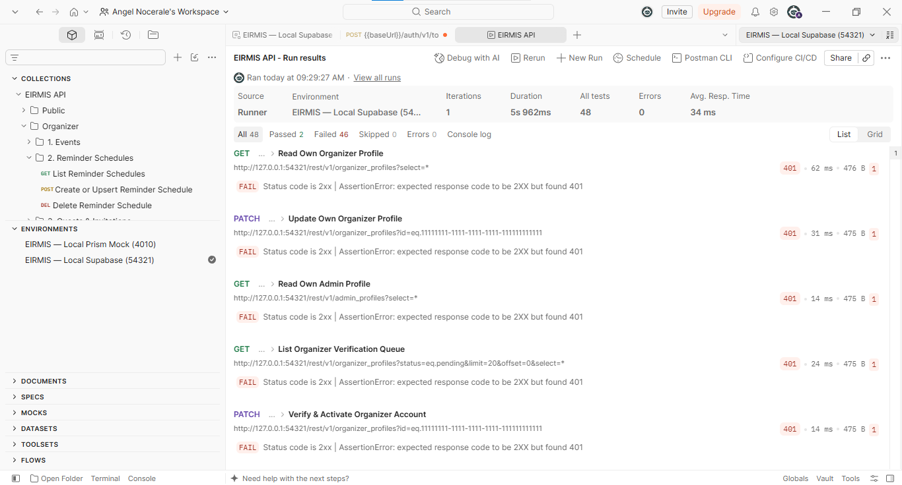

**2. Reminders**
*Shows three reminder schedule requests, all marked FAIL with 401 responses: GET, POST, and DELETE.*
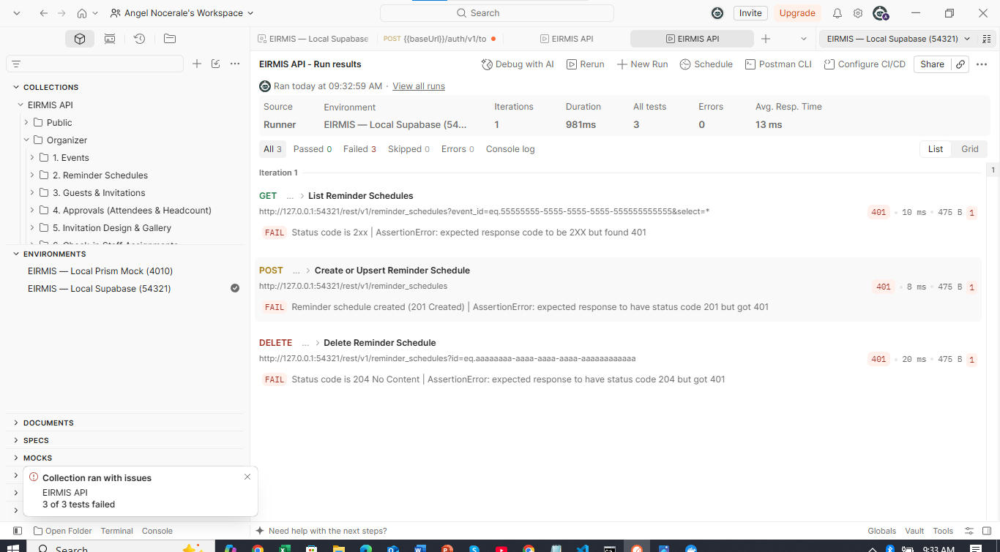

**3. Guests & Invitations**
*Shows four guests and invitations requests, all marked FAIL with 401 responses, including GET, POST, and PATCH requests.*
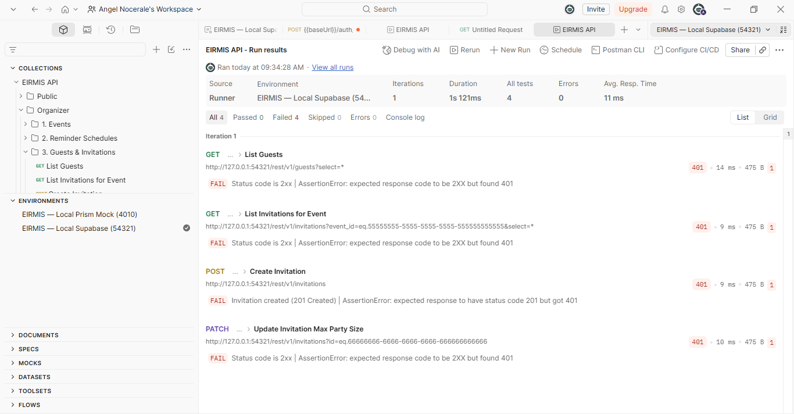

**4. Approvals**
*Shows four approval requests marked FAIL: three returned 401 and the headcount increase decision request returned 404.*
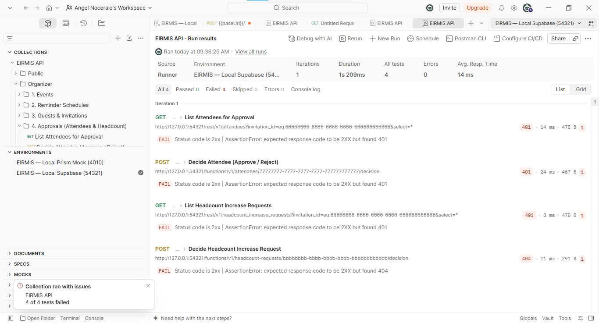

**5. Invitation Design & Gallery**
*Shows the invitation design and gallery run with 7 tests, 0 passed, and 7 failed; the visible requests include 401 responses and a 404 for Upload HTML Invitation File.*
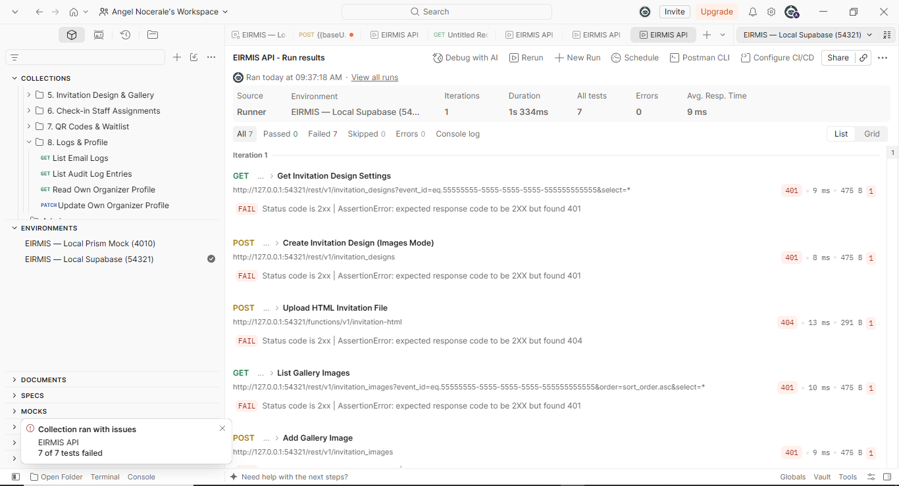

**6. Check-in Staff Assignments**
*Shows four check-in staff assignment requests, all marked FAIL with 401 responses.*
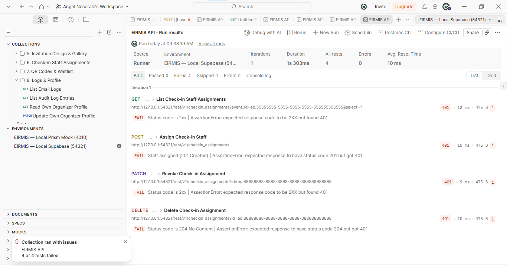

**7. QR Codes & Waitlist**
*Shows two QR and waitlist requests, both marked FAIL: Dispatch QR Code PDF Bundle returned 401 and Promote Waitlisted Guest returned 404.*
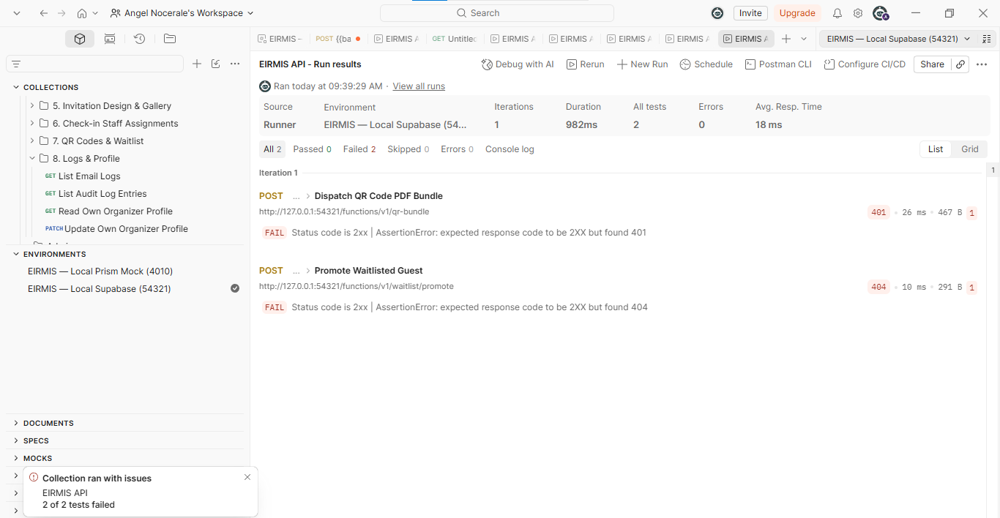

**8. Logs & Profile**
*Shows four logs and profile requests, all marked FAIL with 401 responses.*
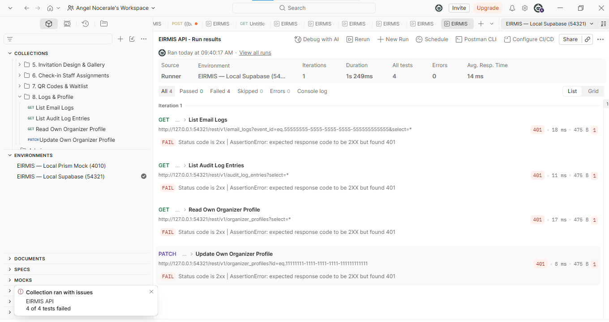

**9. Admin**
*Shows three admin requests, all marked FAIL with 401 responses.*
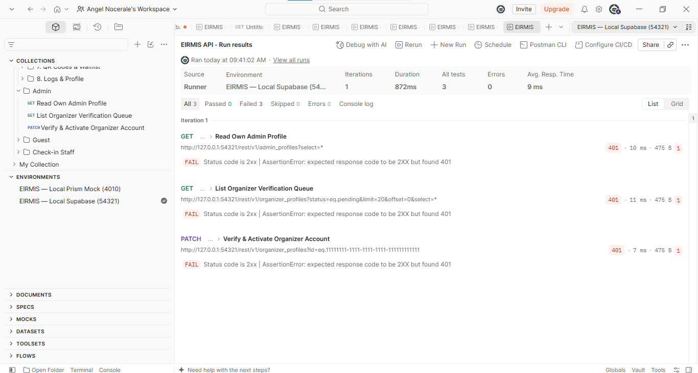

**10. Guest**
*Shows the guest run with 8 tests, 0 passed, and 8 failed; the visible requests are marked FAIL with 401 responses.*
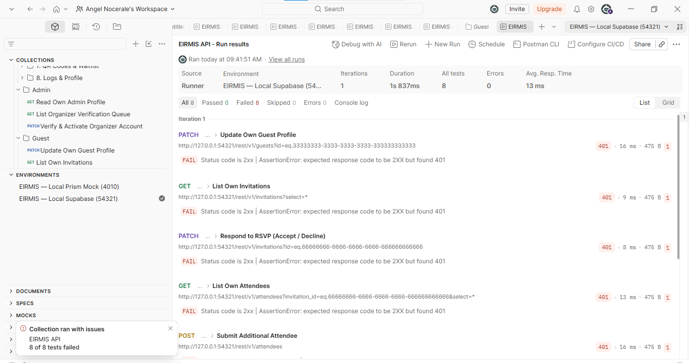

**11. Check-in Staff**
*Shows two check-in staff requests, both marked FAIL: Read Assigned Event Details returned 401 and Scan QR Token and Record Check-in returned 404.*
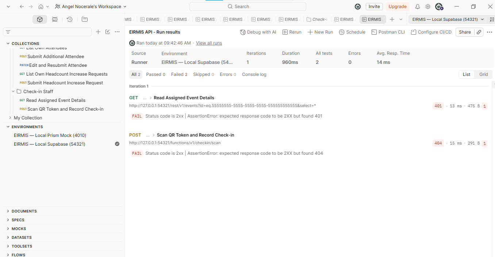

**12. Manual Organizer Login Verification**
*Shows a POST request to the auth token endpoint returning 500 Internal Server Error with the message "Database error querying schema."*
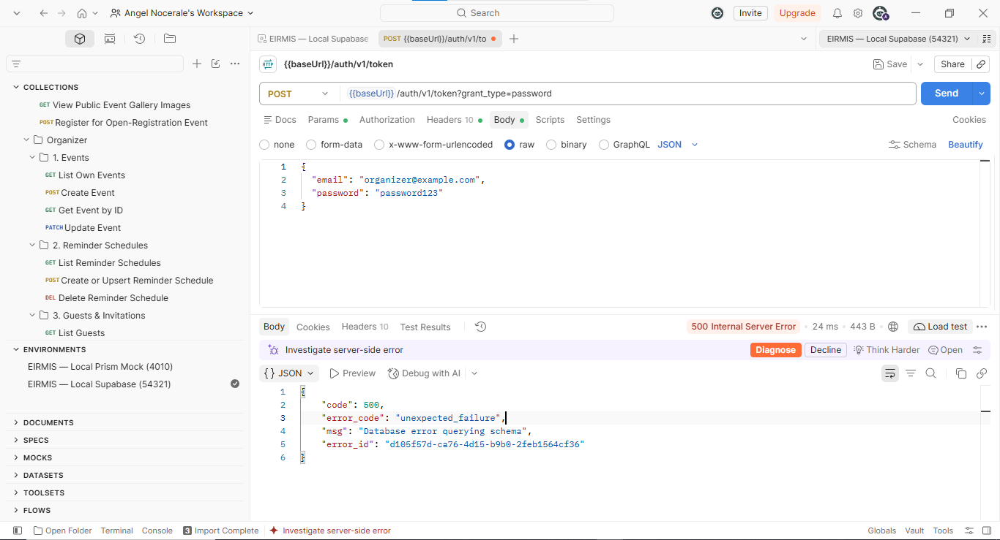

---

### Appendix: Defect Details

#### Title: [API][Multiple Roles][POST] /auth/v1/token - Seeded users cannot obtain valid role tokens

**1. Environment & Setup**
- **Target:** [ ] Prism Mock (`:4010`)  [x] Supabase Local (`:54321`)
- **Git Commit / Branch:** `4e1df11` / `feat/backend-core-functionality`
- **Auth Role Used:** Seeded organizer credentials; no valid role token was obtained
- **Postman Request Name:** `Manual verification: POST /auth/v1/token`

**2. Request Details**
```bash
curl -X POST "http://127.0.0.1:54321/auth/v1/token?grant_type=password" \
  -H "apikey: {{anonKey}}" \
  -H "Content-Type: application/json" \
  -d '{"email":"organizer@example.com","password":"password123"}'
```

**3. Steps to Reproduce**
1. Reset the local database with `supabase db reset`.
2. Start the local Supabase stack and run `npx supabase functions serve`.
3. Select the local Supabase environment in Postman.
4. Send the password-grant request with seeded user credentials.
5. Run the authenticated role requests with the empty role-token variables.

**4. Expected Behavior**
- Expected status and token response: `200 OK`.

**5. Actual Behavior**
- Actual status: `500 Internal Server Error`.
- Actual response body:
```json
{
  "code": 500,
  "error_code": "unexpected_failure",
  "msg": "Database error querying schema",
  "error_id": "d105f57d-ca76-4d15-9b0b-2feb1564cf36"
}
```
- The 401 response body was:
```json
{
  "code": "PGRST303",
  "details": null,
  "hint": null,
  "message": "JWT expired"
}
```
- The 41 authenticated requests below returned `401` with response message `JWT expired`:

| Folder > Request | Status |
|---|---:|
| Organizer > 1. Events > List Own Events | 401 |
| Organizer > 1. Events > Create Event | 401 |
| Organizer > 1. Events > Get Event by ID | 401 |
| Organizer > 1. Events > Update Event | 401 |
| Organizer > 2. Reminder Schedules > List Reminder Schedules | 401 |
| Organizer > 2. Reminder Schedules > Create or Upsert Reminder Schedule | 401 |
| Organizer > 2. Reminder Schedules > Delete Reminder Schedule | 401 |
| Organizer > 3. Guests & Invitations > List Guests | 401 |
| Organizer > 3. Guests & Invitations > List Invitations for Event | 401 |
| Organizer > 3. Guests & Invitations > Create Invitation | 401 |
| Organizer > 3. Guests & Invitations > Update Invitation Max Party Size | 401 |
| Organizer > 4. Approvals (Attendees & Headcount) > List Attendees for Approval | 401 |
| Organizer > 4. Approvals (Attendees & Headcount) > Decide Attendee (Approve / Reject) | 401 |
| Organizer > 4. Approvals (Attendees & Headcount) > List Headcount Increase Requests | 401 |
| Organizer > 5. Invitation Design & Gallery > Get Invitation Design Settings | 401 |
| Organizer > 5. Invitation Design & Gallery > Create Invitation Design (Images Mode) | 401 |
| Organizer > 5. Invitation Design & Gallery > List Gallery Images | 401 |
| Organizer > 5. Invitation Design & Gallery > Add Gallery Image | 401 |
| Organizer > 5. Invitation Design & Gallery > Update Gallery Image | 401 |
| Organizer > 5. Invitation Design & Gallery > Delete Gallery Image | 401 |
| Organizer > 6. Check-in Staff Assignments > List Check-in Staff Assignments | 401 |
| Organizer > 6. Check-in Staff Assignments > Assign Check-in Staff | 401 |
| Organizer > 6. Check-in Staff Assignments > Revoke Check-in Assignment | 401 |
| Organizer > 6. Check-in Staff Assignments > Delete Check-in Assignment | 401 |
| Organizer > 7. QR Codes & Waitlist > Dispatch QR Code PDF Bundle | 401 |
| Organizer > 8. Logs & Profile > List Email Logs | 401 |
| Organizer > 8. Logs & Profile > List Audit Log Entries | 401 |
| Organizer > 8. Logs & Profile > Read Own Organizer Profile | 401 |
| Organizer > 8. Logs & Profile > Update Own Organizer Profile | 401 |
| Admin > Read Own Admin Profile | 401 |
| Admin > List Organizer Verification Queue | 401 |
| Admin > Verify & Activate Organizer Account | 401 |
| Guest > Update Own Guest Profile | 401 |
| Guest > List Own Invitations | 401 |
| Guest > Respond to RSVP (Accept / Decline) | 401 |
| Guest > List Own Attendees | 401 |
| Guest > Submit Additional Attendee | 401 |
| Guest > Edit and Resubmit Attendee | 401 |
| Guest > List Own Headcount Increase Requests | 401 |
| Guest > Submit Headcount Increase Request | 401 |
| Check-in Staff > Read Assigned Event Details | 401 |


[Terminal Auth Log](images/2026-11-06/terminal-log%20evidence-.txt)

**6. Probable Cause**
- The terminal log reports `converting NULL to string is unsupported` while scanning the `confirmation_token` column during the password-grant request. The cause of the null value is not verified in the run evidence.

**7. Severity & Impact**
- **Severity:** [x] Critical  [ ] High  [ ] Medium  [ ] Low
- **Impact:** Seeded users could not obtain valid role tokens, so 41 authenticated requests were blocked and could not be executed.

#### Title: [API][Multiple Roles][POST] /functions/v1/register - Collection paths do not match served Edge Functions

**1. Environment & Setup**
- **Target:** [ ] Prism Mock (`:4010`)  [x] Supabase Local (`:54321`)
- **Git Commit / Branch:** `4e1df11` / `feat/backend-core-functionality`
- **Auth Role Used:** Public request and empty role tokens for role-scoped requests
- **Postman Request Name:** `Public > Register for Open-Registration Event`

**2. Request Details**
```bash
curl -X POST "http://127.0.0.1:54321/functions/v1/register" \
  -H "apikey: {{anonKey}}" \
  -H "Content-Type: application/json" \
  -d '{"event_id":"<EVENT_ID>","email":"newguest@example.com","full_name":"Juan dela Cruz"}'
```

**3. Steps to Reproduce**
1. Reset the local database with `supabase db reset`.
2. Start the local Supabase stack and run `npx supabase functions serve`.
3. Select the local Supabase environment in Postman.
4. Send each request using the collection path.

**4. Expected Behavior**
- The contract specifies `201 Created` for `/functions/v1/register` and `200 OK` for `/functions/v1/headcount-requests/{id}/decision`, `/functions/v1/invitation-html`, `/functions/v1/waitlist/promote`, and `/functions/v1/checkin/scan`.

**5. Actual Behavior**
- Actual response for each listed request: `404 Not Found`.
- Actual response body/message: `Function not found`.

| Collection path | Served function name | Observed status |
|---|---|---:|
| `/functions/v1/register` | `register-public` | 404 |
| `/functions/v1/headcount-requests/{hirId}/decision` | Not listed in served-function list | 404 |
| `/functions/v1/invitation-html` | Not listed in served-function list | 404 |
| `/functions/v1/waitlist/promote` | `waitlist-promote` | 404 |
| `/functions/v1/checkin/scan` | Not listed in served-function list | 404 |


**6. Probable Cause**
- The collection paths do not match the served function names for the paths where an obvious served-function match is available. The remaining three function names were not listed among the served functions for this run.

**7. Severity & Impact**
- **Severity:** [ ] Critical  [ ] High  [x] Medium  [ ] Low
- **Impact:** Five collection requests returned `404 Not Found` with `Function not found` instead of reaching a served Edge Function.
