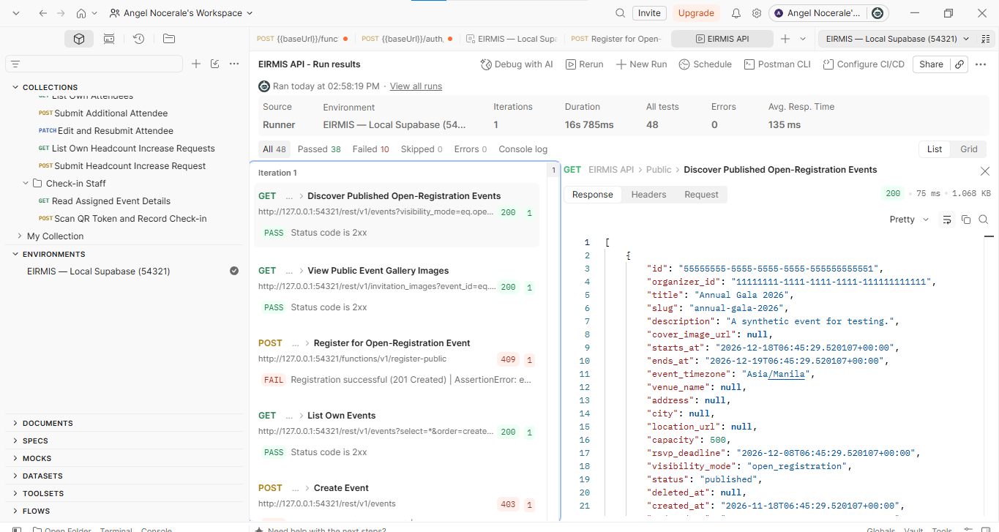
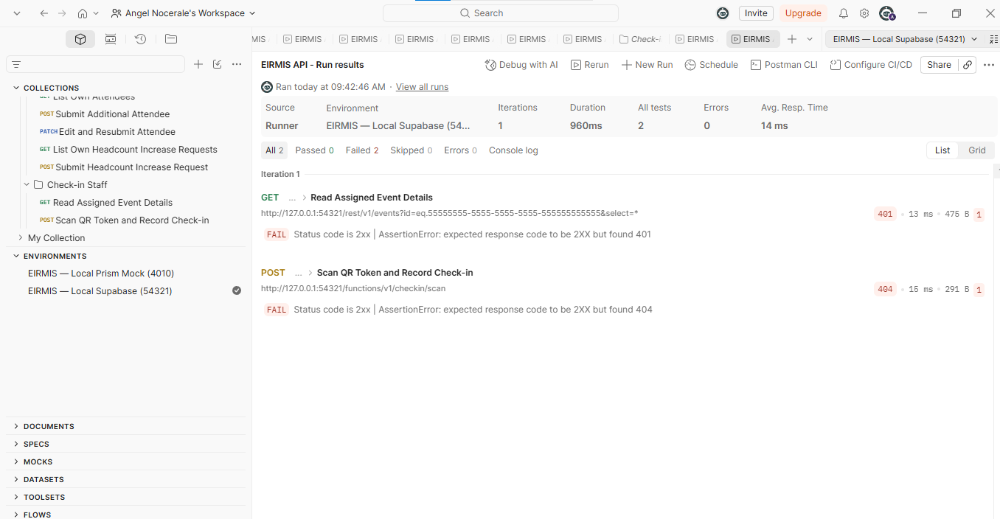

# QA Test Run Report: EIRMIS API - Local Supabase M3 Backend Regression Run

- **Date & Time:** 2026-11-17 2:43:33 PM (Local Time)
- **QA Engineer:** Angel Nocerale
- **Git Commit / Branch:** 4e1df11 / feat/backend-core-functionality
- **Target Environment:** 
  - [ ] Stoplight Prism Mock (`http://127.0.0.1:4010`)
  - [x] Local Supabase Dev (`http://127.0.0.1:54321`)
  - [ ] Staging / Hosted Supabase
- **Postman Collection Version:** v0.1.0 (`EIRMIS API`)
- **Execution Mode:** Postman Collection Runner & Manual Request Verification

---

### Executive Summary

| Total Endpoints | Passed | Failed | Blocked | Pass Rate | Duration |
|:---:|:---:|:---:|:---:|:---:|:---:|
| 48 | 38 | 10 | 0 | 79.17% | 16.79s |

- **Overall Status:** [ ] PASS  [ ] CONDITIONAL PASS  [x] FAIL
- **Blockers / High Severity Issues :** 
QA-01 (Critical): `POST /rest/v1/checkin_assignments` | Returns `400` (`23502`): `invited_by` is NOT NULL in the database, but the request in the collection does not supply it. Contract/collection and schema disagree.
QA-02 (Medium): `POST /rest/v1/events` | Returns `403` (`42501`) "new row violates row-level security policy" for `organizer@example.com`, whose status is `active`. Still `403` when the request is sent alone. <<VERIFY: root cause not yet confirmed>>
---

### Results by Role / Module

| Module / Role | Endpoints Tested | Pass | Fail | Notes / Discrepancies |
|---|:---:|:---:|:---:|---|
| **Public** | 3 | 2 | 1 | **Failed:** POST(Register for open registration event) request returned 409 message:event is not currently accepting public registrations|
| **Organizer - Events** | 4 | 3 | 1 |**Failed:**  POST(Create Event) returned a 403. code:42501, message: now row violates row-level security policy for table\"events\""
  |
| **Organizer - Reminders** | 3 | 3 | 0 | All requests passed |
| **Organizer - Guests/Invites**| 4 | 4 | 0 | All requests passed |
| **Organizer - Approvals** | 4 | 2 | 2 |**Failed:** POST(Decide Headcount Increase) returned a 404, code: not found, message: headcount request not found . POST(Decide Attendee returned a 404, code: attendee not found) |
| **Organizer - Design/Gallery**| 7 | 6 | 1 | **Failed:** POST(Upload HTML Invitation File) returned a 400, code: upload_400, message: provide one text/html file |
| **Organizer - Staff** | 4 | 3 | 1 |**Failed:**  POST(Assign Checkin Staff) returned a 400, code:23502, message null value in column \"invited_by\" of relation \"checkin_assignments\" violates not-null constraint|
| **Organizer - QR/Waitlist** | 2 | 1 | 1 | **Failed:** POST(Dispatch QR Code PDF Bundle) returned a 404, code: not found, message:invitation not found  |
| **Organizer - Logs/Profile** | 4 | 4 | 0 | All requests passed |
| **Admin** | 3 | 3 | 0 | All requests passed |
| **Guest** | 8 | 6 | 2 | **Failed:** POST(Submit Additional Atteendee) returned a 403, code: 42501. message new row violates row-level security policy for table \"attendees\""
POST(Submit Headcount Request) returned a 403, *code: forbidden, message: the invitation is not eligible for a headcount request*
|
| **Check-in Staff** | 2 | 1 | 1 |  **Failed:** POST(Scan QR Token and Record Check in) returned a 404, code: INVALID_QR_TOKEN, message: unsupported QR token|

---

### Defects Logged During Run

| Defect ID | Severity | Endpoint | Summary |
|---|:---:|---|---|
| QA-01 | Medium | `POST /rest/v1/events` | Returns `403` (`42501`) "new row violates row-level security policy" for `organizer@example.com`, whose status is `active`. Still `403` when the request is sent alone. <<VERIFY: root cause not yet confirmed>>  |
| QA-02 | Medium | `POST /rest/v1/checkin_assignments` | Returns `400` (`23502`): `invited_by` is NOT NULL in the database, but the request in the collection does not supply it. Contract/collection and schema disagree. |
 

---

 ### Test Evidence Attached
- [x] Postman UI Screenshots:

**1. Run Summary & Initial Endpoints**
*Shows the Postman run summary with 48 total tests, 38 passed, 10 failed, 0 skipped, and 0 errors; *

**2. Public**
*Shows three events related requests, two marked PASSED with 200,201,204 responses: GET, POST, and DELETE.*

**2. Reminders**
*Shows three reminder schedule requests, all marked PASSED with 200,201,204 responses: GET, POST, and DELETE.*

**3. Guests & Invitations**
*Shows four guests and invitations requests, all marked PASSED with 200S and 201 responses.*

**4. Approvals**
*Shows two requests marked FAIL and two requests marked PASSED: two returned 200 the other two 404.*

**5. Invitation Design & Gallery**
*Shows the invitation design and gallery run with 7 tests, 6 passed, and 1 failed; the visible requests include 200,201,204 responses and a 404 for Upload HTML Invitation File.*

**6. Check-in Staff Assignments**
*Shows four check-in staff assignment requests, three marked PASS, one marked FAILED.*

**7. QR Codes & Waitlist**
*Shows two QR and waitlist requests, both marked FAIL: Dispatch QR Code PDF Bundle and Promote Waitlisted Guest returned 404.*

**8. Logs & Profile**
*Shows four logs and profile requests, all marked PASS with 200 responses.*

**9. Admin**
*Shows three admin requests, all marked PASS with 200 responses.*

**10. Guest**
*Shows the guest run with 8 tests, 6 passed, and 2 failed; the visible requests are marked FAIL with 403 responses.*

**11. Check-in Staff**
*Shows two check-in staff requests, one marked FAIL the other marked PASS: Read Assigned Event Details returned 200 and Scan QR Token and Record Check-in returned 404.*

**12. Manual Organizer Login Verification**
*Shows a POST request to the auth token endpoint returning 500 Internal Server Error with the message "Database error querying schema."*

