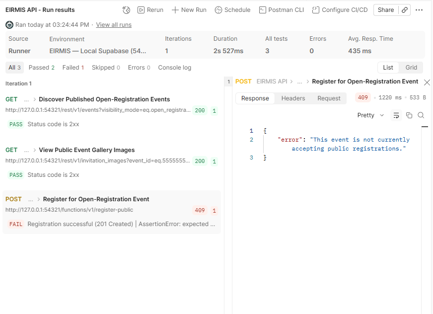
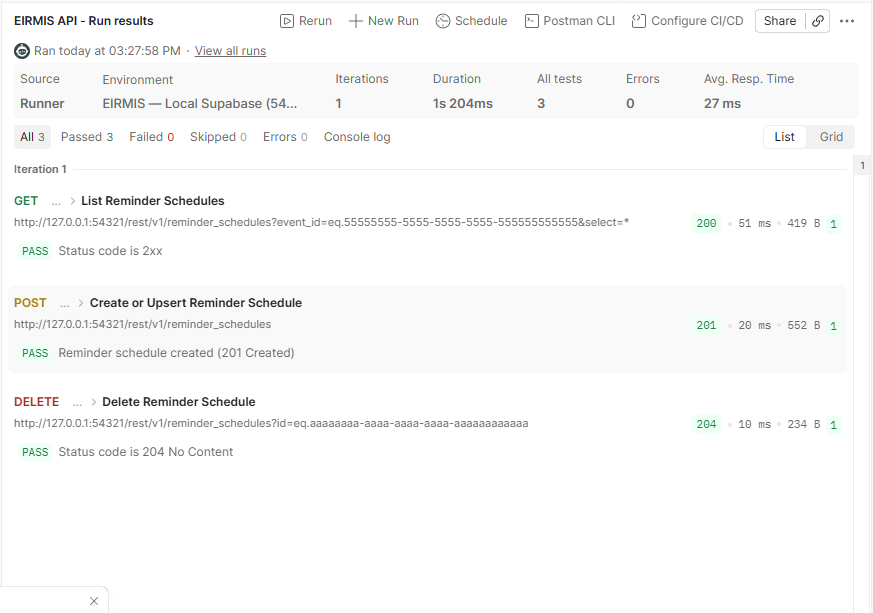
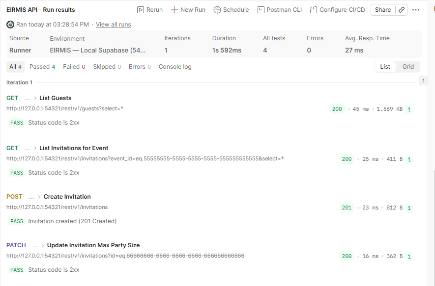
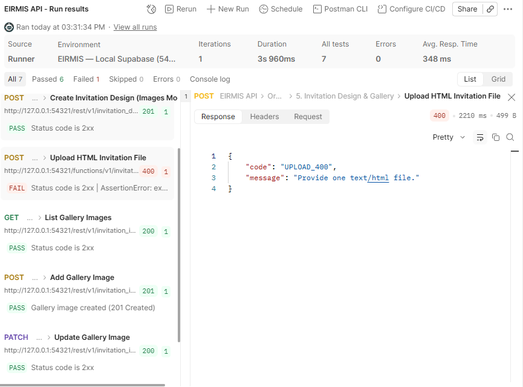
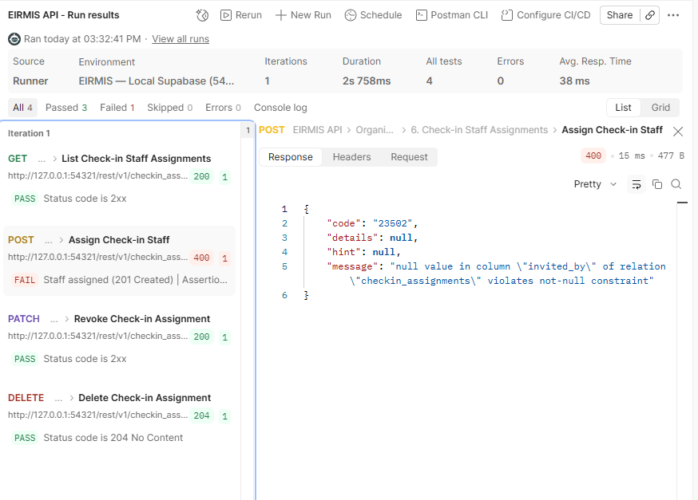
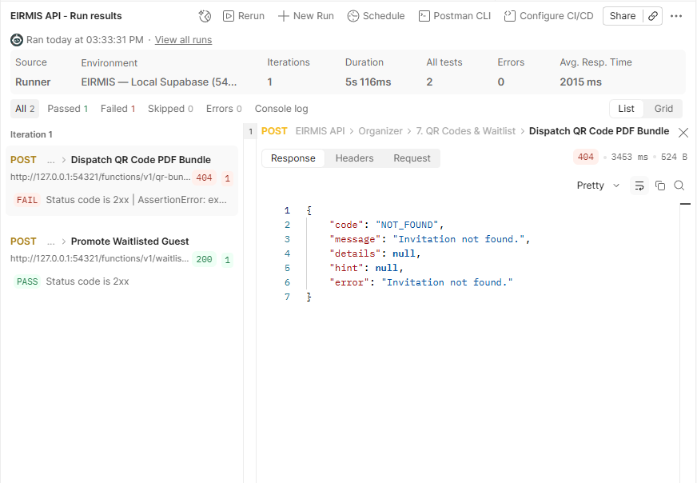
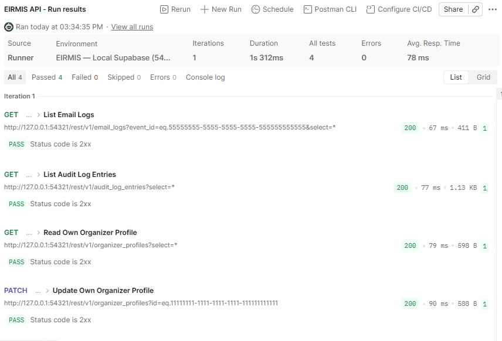
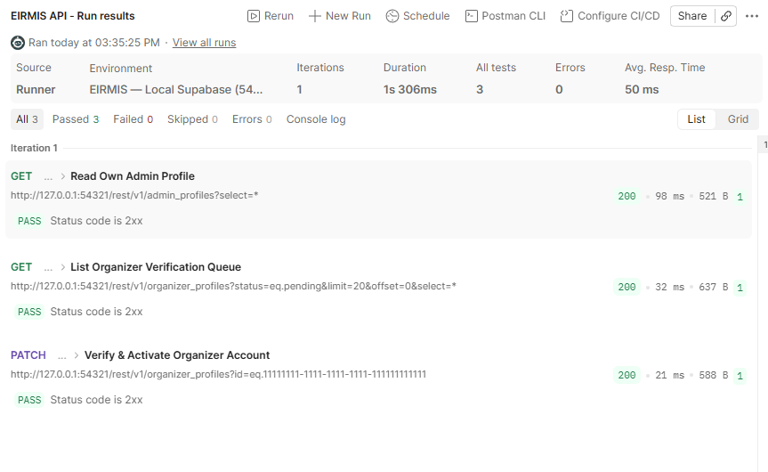

# QA Test Run Report: EIRMIS API - Local Supabase M3 Backend Regression Run

- **Date & Time:** 2026-11-17 2:43:33 PM (Local Time)
- **QA Engineer:** Angel Nocerale
- **Git Commit / Branch:** f1fca3 / feat/m3-backend
- **Target Environment:** 
  - [ ] Stoplight Prism Mock (`http://127.0.0.1:4010`)
  - [x] Local Supabase Dev (`http://127.0.0.1:54321`)
  - [ ] Staging / Hosted Supabase
- **Postman Collection Version:** v0.1.0 (`EIRMIS API`)
- **Execution Mode:** Postman Collection Runner & Manual Request Verification

---

### Executive Summary

| Total Endpoints | Passed | Failed | Blocked | Pass Rate | Duration |
|:---:|:---:|:---:|:---:|:---:|:---:|
| 48 | 38 | 10 | 0 | 79.17% | 16.79s |

- **Overall Status:** [ ] PASS  [ ] CONDITIONAL PASS  [x] FAIL
- **Blockers / High Severity Issues :** 
QA-01 (Critical): `POST /rest/v1/checkin_assignments` | Returns `400` (`23502`): `invited_by` is NOT NULL in the database, but the request in the collection does not supply it. Contract/collection and schema disagree.
QA-02 (Medium): `POST /rest/v1/events` | Returns `403` (`42501`) "new row violates row-level security policy" for `organizer@example.com`, whose status is `active`. Still `403` when the request is sent alone. <<VERIFY: root cause not yet confirmed>>
---

### Results by Role / Module

| Module / Role | Endpoints Tested | Pass | Fail | Notes / Discrepancies |
|---|:---:|:---:|:---:|---|
| **Public** | 3 | 2 | 1 | **Failed:** POST(Register for open registration event) request returned 409 message:event is not currently accepting public registrations|
| **Organizer - Events** | 4 | 3 | 1 |**Failed:**  POST(Create Event) returned a 403. code:42501, message: now row violates row-level security policy for table\"events\""
  |
| **Organizer - Reminders** | 3 | 3 | 0 | All requests passed |
| **Organizer - Guests/Invites**| 4 | 4 | 0 | All requests passed |
| **Organizer - Approvals** | 4 | 2 | 2 |**Failed:** POST(Decide Headcount Increase) returned a 404, code: not found, message: headcount request not found . POST(Decide Attendee returned a 404, code: attendee not found) |
| **Organizer - Design/Gallery**| 7 | 6 | 1 | **Failed:** POST(Upload HTML Invitation File) returned a 400, code: upload_400, message: provide one text/html file |
| **Organizer - Staff** | 4 | 3 | 1 |**Failed:**  POST(Assign Checkin Staff) returned a 400, code:23502, message null value in column \"invited_by\" of relation \"checkin_assignments\" violates not-null constraint|
| **Organizer - QR/Waitlist** | 2 | 1 | 1 | **Failed:** POST(Dispatch QR Code PDF Bundle) returned a 404, code: not found, message:invitation not found  |
| **Organizer - Logs/Profile** | 4 | 4 | 0 | All requests passed |
| **Admin** | 3 | 3 | 0 | All requests passed |
| **Guest** | 8 | 6 | 2 | **Failed:** POST(Submit Additional Atteendee) returned a 403, code: 42501. message new row violates row-level security policy for table \"attendees\""
POST(Submit Headcount Request) returned a 403, *code: forbidden, message: the invitation is not eligible for a headcount request*
|
| **Check-in Staff** | 2 | 1 | 1 |  **Failed:** POST(Scan QR Token and Record Check in) returned a 404, code: INVALID_QR_TOKEN, message: unsupported QR token|


---

### Defects Logged During Run

| Defect ID | Severity | Endpoint | Summary |
|---|:---:|---|---|

| QA-01 | Critical | `POST /rest/v1/checkin_assignments` | Returns `400` (`23502`): `invited_by` is NOT NULL in the database, but the request in the collection does not supply it. Contract/collection and schema disagree. |
| QA-02 | Medium | `POST /rest/v1/events` | Returns `403` (`42501`) "new row violates row-level security policy" for `organizer@example.com`, whose status is `active`. Still `403` when the request is sent alone. |
 

---

 ### Test Evidence Attached
- [x] Postman UI Screenshots:

**1. Run Summary & Initial Endpoints**
*Shows the Postman run summary with 48 total tests, 38 passed, 10 failed, 0 skipped, and 0 errors; *


**2. Public**
*Shows three events related requests, two marked PASS with 200 responses and a 409 for the failed test*


**2. Reminders**
*Shows three reminder schedule requests, all marked PASS with 200,201,204 responses: GET, POST, and DELETE.*


**3. Guests & Invitations**
*Shows four guests and invitations requests, all marked PASSED with 200S and 201 responses.*


**4. Approvals**
*Shows two requests marked FAIL and two requests marked PASSED: two returned 200 the other two 404.*


**5. Invitation Design & Gallery**
*Shows the invitation design and gallery run with 7 tests, 6 passed, and 1 failed; the visible requests include 200,201,204 responses and a 404 for Upload HTML Invitation File.*


**6. Check-in Staff Assignments**
*Shows four check-in staff assignment requests, three marked PASS, one marked FAILED.*


**7. QR Codes & Waitlist**
*Shows two QR and waitlist requests, both marked FAIL: Dispatch QR Code PDF Bundle and Promote Waitlisted Guest returned 404.*


**8. Logs & Profile**
*Shows four logs and profile requests, all marked PASS with 200 responses.*


**9. Admin**
*Shows three admin requests, all marked PASS with 200 responses.*


**10. Guest**
*Shows the guest run with 8 tests, 6 passed, and 2 failed; the visible requests are marked FAIL with 403 responses.*


**11. Check-in Staff**
*Shows two check-in staff requests, one marked FAIL the other marked PASS: Read Assigned Event Details returned 200 and Scan QR Token and Record Check-in returned 404.*


### Appendix: Defect Details

#### Title: [API][Organizer][POST] /rest/v1/checkin_assignments - Returns 400 `invited_by` NOT NULL violation

**1. Environment & Setup**
- **Target:** [ ] Prism Mock (`:4010`)  [x] Supabase Local (`:54321`)
- **Git Commit / Branch:** `feat/m3-backend` 
- **Auth Role Used:** `Bearer {{organizerToken}}` (`organizer@example.com`)
- **Postman Request Name:** `Organizer > 6. Check-in Staff Assignments > Assign Check-in Staff`

**2. Request Details**
```bash
curl -X POST "http://127.0.0.1:54321/rest/v1/checkin_assignments" \
  -H "apikey: <ANON_KEY>" \
  -H "Authorization: Bearer <ORGANIZER_JWT>" \
  -H "Content-Type: application/json" \
  -d '{
  "event_id": "{{eventId}}",
  "staff_email": "staff@example.com"
}'
```

**3. Steps to Reproduce**
1. Reset the local database with `npx supabase db reset`.
2. Start the Edge Functions with `npx supabase functions serve --env-file supabase/functions/.env`.
3. Log in as `organizer@example.com` (`POST /auth/v1/token?grant_type=password`) and save the token in `organizerToken`.
4. Select the local Supabase environment in Postman.
5. Send `Organizer > 6. Check-in Staff Assignments > Assign Check-in Staff`.

**4. Expected Behavior**
- **Expected Status:** `201 Created` (collection assertion: "Staff assigned (201 Created)"). 

**5. Actual Behavior**
- **Actual Status:** `400 Bad Request`
- **Actual Response Body:**
```json
{
  "code": "23502",
  "message": "null value in column \"invited_by\" of relation \"checkin_assignments\" violates not-null constraint"
}
```


**6. Probable Cause**
- The `invited_by` column is NOT NULL, and the request body in the collection does not appear to include it. 
- Not verified: whether the contract lists `invited_by` as a required field, or whether the database is meant to fill it automatically (for example a default or trigger using the logged-in user). Relevant file: `supabase/migrations/20260908000006_checkin.sql`.

**7. Severity & Impact**
- **Severity:** [x] Critical  [ ] High  [ ] Medium  [ ] Low
- **Impact:** An organizer cannot assign check-in staff with the request as defined in the collection.

---

#### Title: [API][Organizer][POST] /rest/v1/events - Returns 403 row-level security violation for the seeded organizer

**1. Environment & Setup**
- **Target:** [ ] Prism Mock (`:4010`)  [x] Supabase Local (`:54321`)
- **Git Commit / Branch:** `feat/m3-backend`
- **Auth Role Used:** `Bearer {{organizerToken}}` (`organizer@example.com`)
- **Organizer status:** `active` in `organizer_profiles` when the request was re-sent on its own after the run. 
- **Postman Request Name:** `Organizer > 1. Events > Create Event`

**2. Request Details**
```bash
curl -X POST "http://127.0.0.1:54321/rest/v1/events" \
  -H "apikey: <ANON_KEY>" \
  -H "Authorization: Bearer <ORGANIZER_JWT>" \
  -H "Content-Type: application/json" \
  -H "Prefer: return=representation" \
  -d '{
    "title": "Annual Gala 2026",
    "slug": "annual-gala-2026",
    "description": "A celebration of achievements and milestones.",
    "starts_at": "2026-12-15T18:00:00+08:00",
    "ends_at": "2026-12-15T22:00:00+08:00",
    "event_timezone": "Asia/Manila",
    "venue_name": "Grand Ballroom",
    "address": "123 Rizal Avenue",
    "city": "Cebu City",
    "capacity": 500,
    "rsvp_deadline": "2026-12-01T23:59:59+08:00",
    "visibility_mode": "invite_only",
    "status": "draft"
}>'
```

**3. Steps to Reproduce**
1. Reset the local database with `npx supabase db reset`.
2. Start the Edge Functions with `npx supabase functions serve --env-file supabase/functions/.env`.
3. Log in as `organizer@example.com` and save the token in `organizerToken`. Confirm with `GET /auth/v1/user` that the token is valid (200).
4. Select the local Supabase environment in Postman.
5. Send `Organizer > 1. Events > Create Event`.
6. Re-send the same request on its own after the collection run (organizer status `active`). It returns the same 403.

**4. Expected Behavior**
- **Expected Status:** `201 Created` (collection assertion: "Event created (201 Created)").

**5. Actual Behavior**
- **Actual Status:** `403 Forbidden`
- **Actual Response Body:**
```json
{
  "code": "42501",
  "details": null,
  "hint": null,
  "message": "new row violates row-level security policy for table \"events\""
}
```


**6. Probable Cause**
- Not determined. The 403 is a Postgres row-level security refusal (`42501`) on the `events` table, not an authentication failure: the token is valid and other organizer requests in the same run returned 2xx.
- Re-sending the request after `organizer@example.com` became `active` did not change the result.
- Not yet verified: whether the request body's organizer identifier matches the logged-in user's id (`11111111-1111-1111-1111-111111111111`), and what the INSERT policy on `events` requires (Studio > Authentication > Policies > `events`; migrations `20260908000003_events.sql` and `20260917064854_fix_rls_recursion.sql`).

**7. Severity & Impact**
- **Severity:** [ ] Critical  [ ] High  [x] Medium  [ ] Low
- **Impact:** The seeded organizer could not create an event through this request. Whether other request bodies or other organizers are affected was not tested.

---

#### Failed Assertions Not Logged as Defects

Eight of the ten failed requests are not logged as defects. Each returned a specific, expected-looking response from the backend, and the cause lies in the collection's test data or in the test environment.

| Request | Status | Response message | Cause | Verification |
|---|:---:|---|---|---|

| Register for Open-Registration Event | 502 | Registration was created, but the confirmation email could not be sent. | Resend rejects `example.com` recipients and unverified senders. The registration itself was created. | With recipient `delivered@resend.dev` and sender `onboarding@resend.dev`, the same request returned `201`. |

| Decide Attendee (Approve / Reject) | 404 | Attendee not found | The collection's `attendeeId` (`77777777-7777-7777-7777-777777777777`) is not in `seed.sql`. The seed contains `...771` to `...776`. | SQL query on `attendees`. Manual retest with seeded attendee`77777777-7777-7777-7777-777777777771`: returned `502` Decision saved but the QR bundle request failed |

| Decide Headcount Increase Request | 400 | Headcount request not found | The collection's `hirId` (`bbbbbbbb-bbbb-bbbb-bbbb-bbbbbbbbbbbb`) is not in the seed. The seed contains `...bbb1` to `...bbb3`. | SQL query on `headcount_increase_requests`. Manual retest with `...bbb1`: returned `200` |

| Upload HTML Invitation File | 400 | Provide one text/html file. | The Collection Runner cannot attach a local file, so the function received no file. | Not yet verified with manual retest |

| Dispatch QR Code PDF Bundle | 404 | Invitation not found | The collection's `invitationId` (`66666666-6666-6666-6666-666666666666`) is not in the seed. The seed contains `...661` to `...665`. | SQL query on `invitations`. Manual retest with a seeded invitation: <66666666-6666-6666-6666-666666666661: Internal Server Error. |

| Submit Additional Attendee | 403 | New row violates row-level security policy for table "attendees" | Likely the collection's invitation (`...666`) does not exist, so the policy check fails.| retest with seeded invitation `...661` : returned `201` |

| Submit Headcount Increase Request | 403 | The invitation is not eligible for a headcount request. | The collection's invitation does not exist in the seed, or is not in an eligible status. | retest with seeded invitation `...662`: returned `502` Request was saved, but the organizer notification could not be sent. |

| Scan QR Token and Record Check-in | 422 | Unsupported QR token | The collection sends a placeholder token, not a real signed token. | Manual retest with a real token of an approved attendee: token-primary-001: 2XX. |

**Recommended follow-up:** file one issue for the collection's default IDs (`attendeeId`, `invitationId`, `hirId`) not matching `supabase/seed.sql`, because it affects at least four requests.