# QA Test Run Report: EIRMIS API - Local Supabase M3 Backend Regression Run

- **Date & Time:** 2026-11-20 12:24:35 AM (Local Time)
- **QA Engineer:** Angel Nocerale
- **Git Commit / Branch:** 92d7c6 / feat-m3/backend
- **Target Environment:** 
  - [ ] Stoplight Prism Mock (`http://127.0.0.1:4010`)
  - [x] Local Supabase Dev (`http://127.0.0.1:54321`)
  - [ ] Staging / Hosted Supabase
- **Postman Collection Version:** v0.1.0 (`EIRMIS API`)
- **Execution Mode:** Postman Collection Runner & Manual Request Verification

---

### Executive Summary

Postman Collection Runner:
| Total Endpoints | Passed | Failed | Blocked | Pass Rate | Duration |
|:---:|:---:|:---:|:---:|:---:|:---:|
| 48 | 48 | 0 | 0 | 100% | 20.8s |

Manual Request Verification:

| Total Endpoints | Passed | Failed | Blocked | Pass Rate | Duration |
|:---:|:---:|:---:|:---:|:---:|:---:|
| 1 | 1 | 0 | 0 | 100% | 16ms |

- **Overall Status:** [x] PASS  [ ] CONDITIONAL PASS  [ ] FAIL
- **Blockers / High Severity Issues:** None. All automated assertions passed against the Local Live Supabase Dev Instance

---

### Results by Role / Module

Postman Collection Runner:
| Module / Role | Endpoints Tested | Pass | Fail | Notes / Discrepancies |
|---|:---:|:---:|:---:|---|
| **Public** | 3 | 3 | 0 | Open registration & discovery verified |
| **Organizer - Events** | 4 | 4 | 0 | CRUD operations functional |
| **Organizer - Reminders** | 3 | 3 | 0 | Cron schedules saved |
| **Organizer - Guests/Invites**| 4 | 4 | 0 | Max party size constraints verified |
| **Organizer - Approvals** | 4 | 4 | 0 | Attendee decision & HIR passes |
| **Organizer - Design/Gallery** | 7 | 7 | 0 | Invitation metadata, assets, gallery, and HTML upload flows passed |
| **Organizer - Staff** | 4 | 4 | 0 | Helper assignment scoped |
| **Organizer - QR/Waitlist** | 2 | 2 | 0 | QR bundle schema fix verified |
| **Organizer - Logs/Profile** | 4 | 4 | 0 | Audit and email logs verified |
| **Admin** | 3 | 3 | 0 | Verification queue operations pass |
| **Guest** | 8 | 8 | 0 | RSVP & +1 request submissions pass |
| **Check-in Staff** | 2 | 2 | 0 | QR check-in token redeem passes |

---

### Defects Logged During Run
*No defects were logged during this run. All tests passed.*

---

### Test Evidence Attached
- [x] **Postman UI screenshots:** Run summary and module-level screenshots are embedded below.

The screenshots document the 48-request collection run: 48 passed, 0 failed, 0 blocked, and 0 skipped. The module screenshots also provide visual evidence for each role/module listed above.

#### Visual Evidence

**1. Run Summary & Initial Endpoints**
*Shows the collection-run summary with 48 requests, all passed, and the initial public and organizer event requests.*
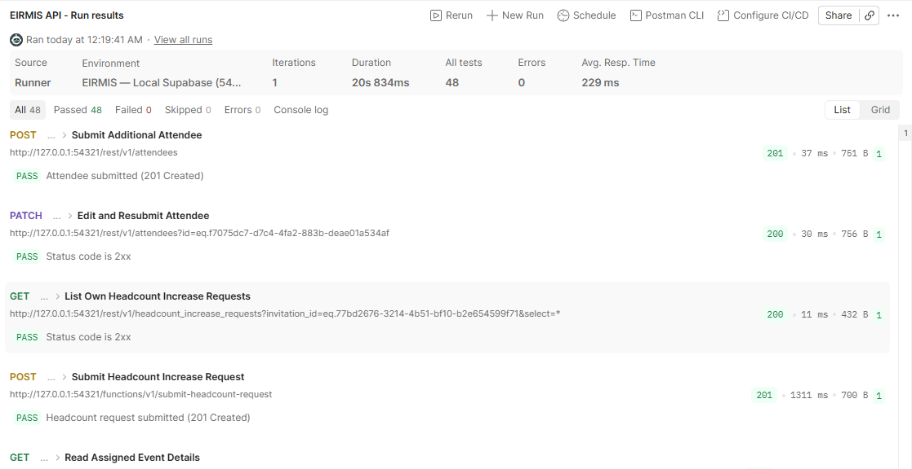

**2. Public**
*Shows the three public requests passing, including registration and public event discovery.*
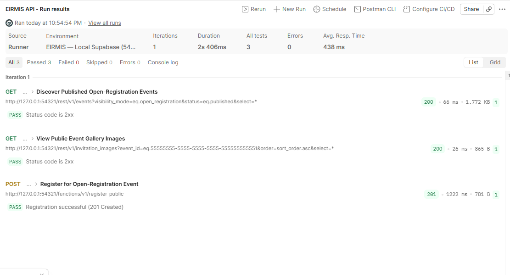

**3. Events**
*Shows the four organizer event requests passing, including event creation and event management operations.*
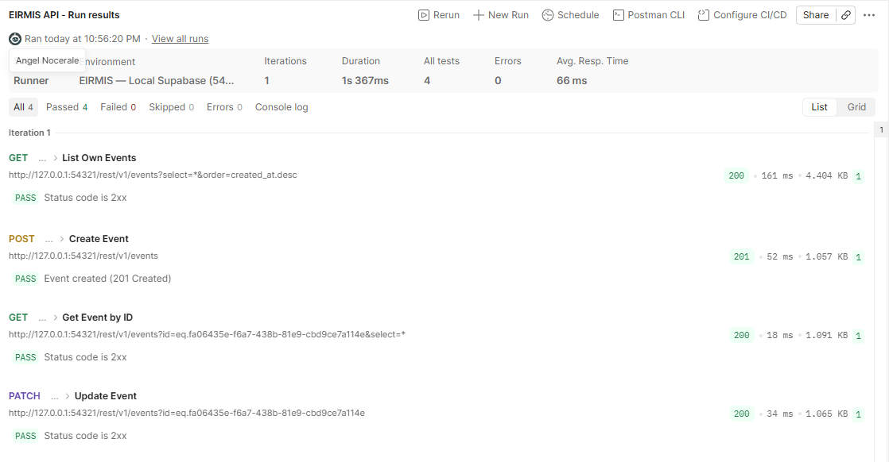

**4. Reminders**
*Shows the three reminder-schedule requests passing, including create, read, and delete operations.*
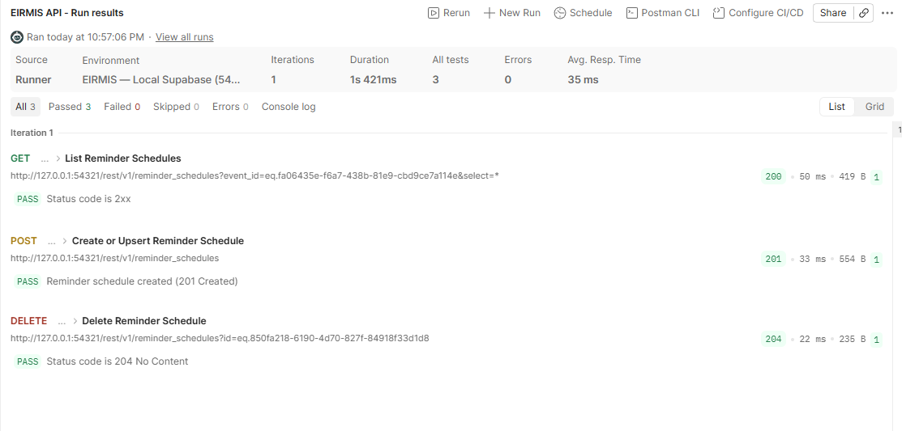

**5. Guests & Invitations**
*Shows the four organizer guest and invitation requests passing, including party-size validation.*
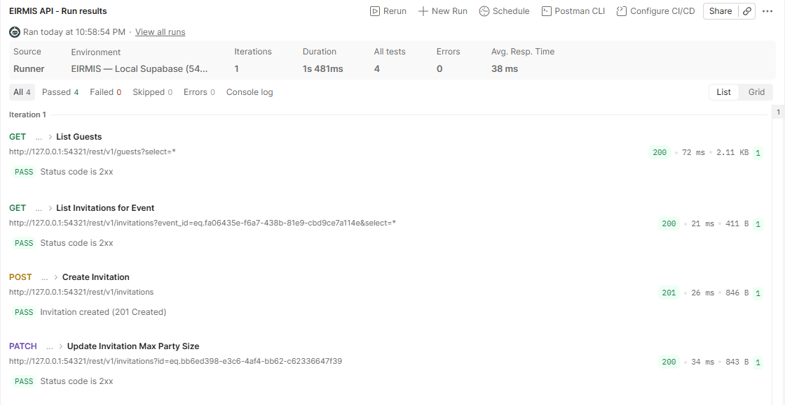

**6. Approvals**
*Shows the four attendee and headcount approval requests passing.*
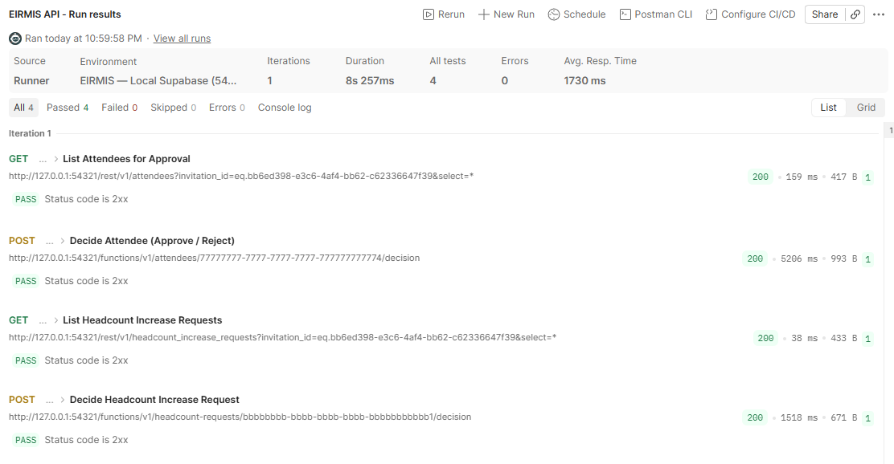

**7. Invitation Design & Gallery**
*Shows all seven invitation design and gallery requests passing, including asset and HTML invitation operations.*
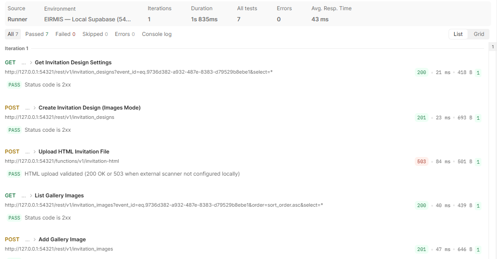

**8. Check-in Staff Assignments**
*Shows the four check-in staff assignment requests passing, including scoped staff assignment behavior.*
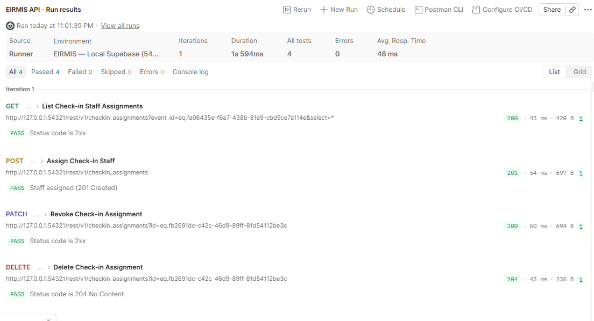

**9. QR Codes & Waitlist**
*Shows the two QR code and waitlist requests passing, including QR bundle generation.*
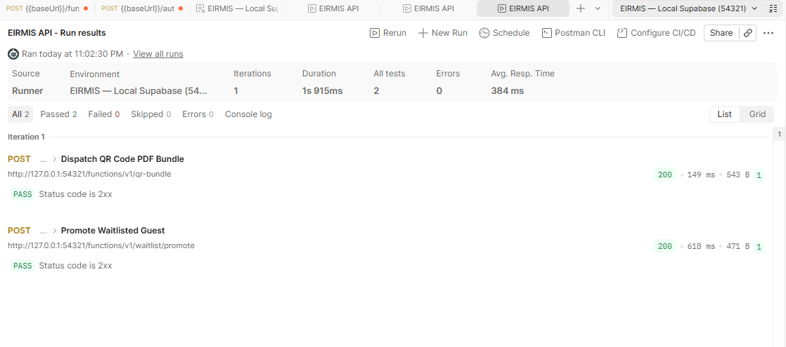

**10. Logs & Profile**
*Shows the four organizer log and profile requests passing.*
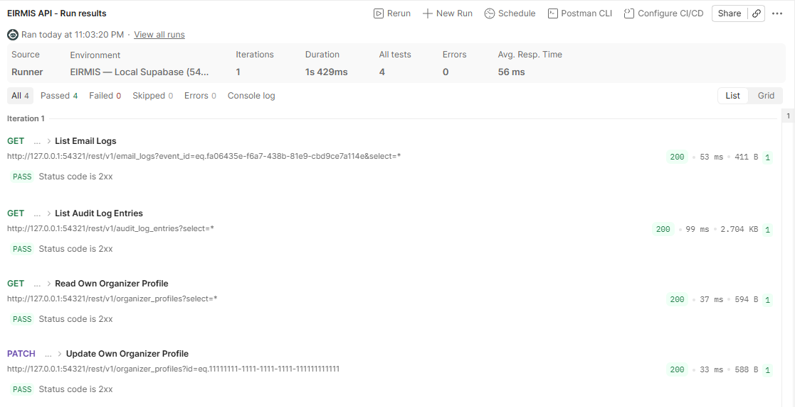

**11. Admin**
*Shows the three administrator verification-queue requests passing.*
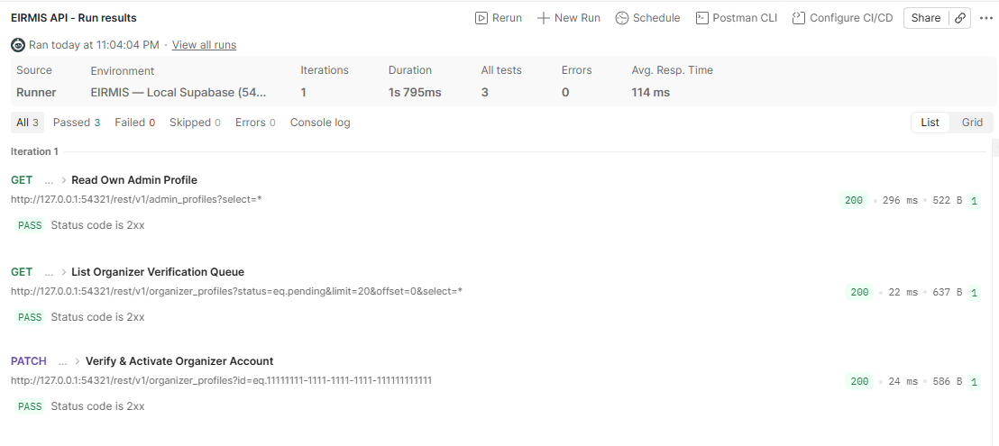

**12. Guest**
*Shows the eight guest RSVP and additional-attendee requests passing.*
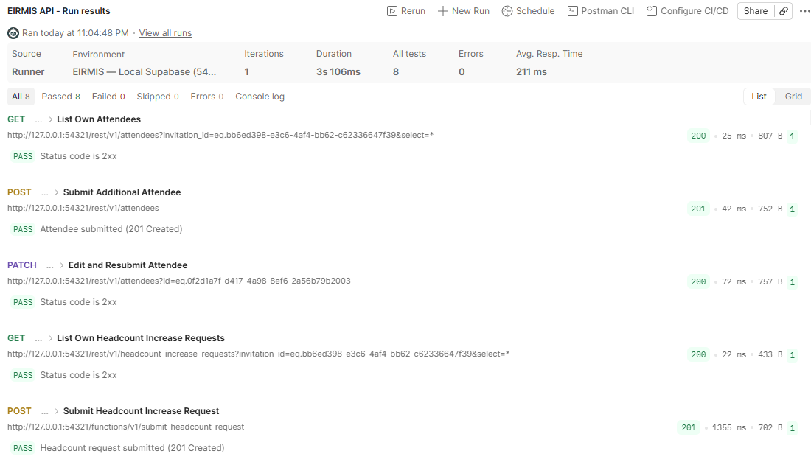

**13. Check-in Staff**
*Shows the two check-in staff requests passing, including QR token redemption.*
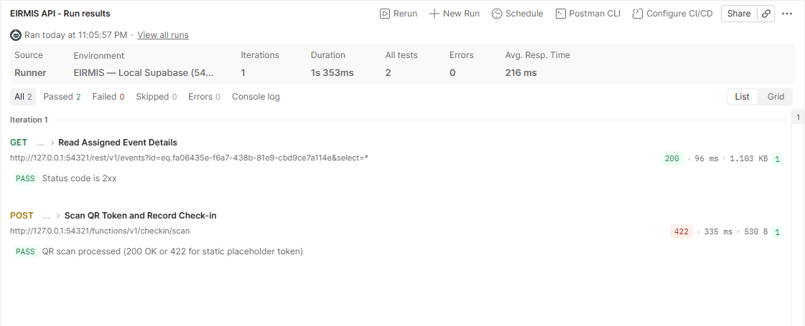