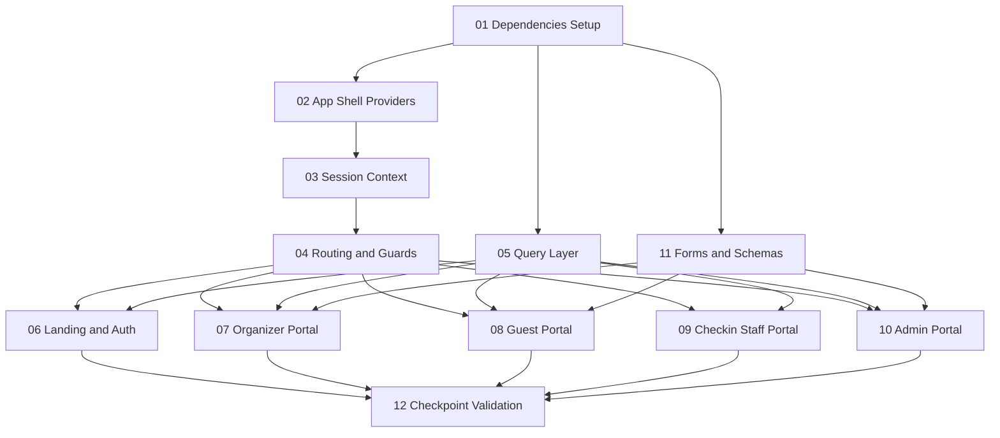
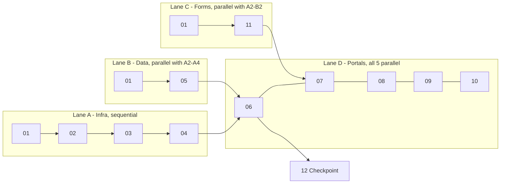

# EIRMIS M4 Frontend — Week 1 Plan

> **Scope:** Week 1 of Milestone 4 (Frontend on mock) only — from kickoff through the **end-of-week checkpoint**.
> **Checkpoint gate:** the main flow — *event → invite → RSVP → approve → QR → check-in* — works end-to-end on MSW for every role.
> Week 2 (all-states coverage, tests, a11y) is planned separately after this checkpoint.

> ⚠️ **Scheduling note:** This plan is **dependency-ordered, not date-bound**. Day assignments will be made on the GitHub issue board once the M2 submission (currently under review) is approved and the contract is final. Until then, treat the order and dependencies below as the source of truth.

---

## 1. How to use this plan

Each task lives in its own folder with three files:

| File | What it contains |
|---|---|
| `task.md` | Scope, owner, order, files to create/modify, step-by-step work breakdown |
| `dependencies.md` | **Blocked-by / blocks / parallel-with** analysis, contract operations consumed, shared-file conflict warnings |
| `acceptance-criteria.md` | Done-when checklist the assignee (or reviewer) verifies before closing the task |

---

## 2. Team & task index

**Frontend team:** Jian Villasotes · Genesis AR S. Oreiro · Gian Suico · Cerna Ronald · Jebron Ortula · Martin Ybas · Pete Piangco · Edgar Jay-ar Alkuino Rodriguez · **Andrei Kahano (Lead)**

| # | Task folder | Order | Owner | Lane |
|---|---|---|---|---|
| 01 | [`task-01-dependencies-setup/`](task-01-dependencies-setup/task.md) | 1st — root | Lead | A+B+C (root) |
| 02 | [`task-02-app-shell-providers/`](task-02-app-shell-providers/task.md) | 2nd | Lead | A |
| 03 | [`task-03-session-context/`](task-03-session-context/task.md) | 3rd | Lead | A |
| 04 | [`task-04-routing-guards/`](task-04-routing-guards/task.md) | 4th | Lead | A |
| 05 | [`task-05-query-layer/`](task-05-query-layer/task.md) | after 01, parallel with A | Dev 2 | B |
| 06 | [`task-06-landing-auth/`](task-06-landing-auth/task.md) | after 04 + 05 | Dev 1 | D |
| 07 | [`task-07-organizer-portal/`](task-07-organizer-portal/task.md) | after 04 + 05 (+11 for forms) | Dev 1 | D |
| 08 | [`task-08-guest-portal/`](task-08-guest-portal/task.md) | after 04 + 05 (+11 for forms) | Dev 2 | D |
| 09 | [`task-09-checkin-staff-portal/`](task-09-checkin-staff-portal/task.md) | after 04 + 05 | Dev 3 | D |
| 10 | [`task-10-admin-portal/`](task-10-admin-portal/task.md) | after 04 + 05 (+11 for settings) | Dev 4 | D |
| 11 | [`task-11-forms-schemas/`](task-11-forms-schemas/task.md) | after 01, parallel with A and B | Dev 4 | C |
| 12 | [`task-12-checkpoint-validation/`](task-12-checkpoint-validation/task.md) | final — after 06–10 | Whole team | Gate |

> Owner labels (Dev 1–4) are placeholders — exact name-to-task assignment happens on the issue board after M2 approval. Remaining team members pick up Week 2 workstreams (tests, a11y, all-states) or pair on portals.

---

## 3. Dependency graph

---

## 4. Parallel lanes — what can run at the same time

### Parallelism rules

| Rule | Detail |
|---|---|
| **01 is the single root** | Nothing starts until deps are installed. It is a 30-minute task — do it first. |
| **05 and 11 run parallel to 02–04** | The query layer and Zod schemas are pure TypeScript with no router/session dependency. Assign them to a different person than the lead doing 02–04. |
| **06–10 are fully parallel with each other** | One person per portal. Each portal slice touches only its own `src/features/<portal>/` folder. |
| **06 has the lightest dependency set** | Needs only 04 + 05 (no forms). Start it as soon as 04 and 05 land. |
| **07 and 08 need 11** | Their core screens are form-heavy (create-event wizard, RSVP roster). They may *start* (list views) before 11 lands, but form screens wait. |
| **09 needs only 04 + 05** | The scan flow is a single mutation + result state machine — no forms task dependency. |
| **10 needs 11 for org settings** | The settings form waits for 11; the verification queue (list + status mutation) does not. |
| **12 gates on everything** | No task is "done" for the week until 12 passes. |

### Shared-file conflict map (the only files multiple people touch)

| File | Touched by | Mitigation |
|---|---|---|
| `src/app/router.tsx` | 04 owner only | Portals never edit the router; they request route slots via the task board |
| `src/lib/api/query-keys.ts` | 05 owner only | Portal devs consume keys, never edit them |
| `src/app/providers/` | 02, 03 owners only | Sequential within Lane A |
| `package.json` | 01 owner only | One install commit; nobody else adds deps during Week 1 |

Everything else is isolated per portal: `src/features/organizer/**`, `src/features/guest/**`, `src/features/checkin/**`, `src/features/admin/**`, `src/features/landing/**`.

---

## 5. System design summary (full detail in each task)

**Layered architecture** — M2 already shipped the bottom two layers; Week 1 builds the top three:

| Layer | Location | Status |
|---|---|---|
| Presentation (pages, portal layouts) | `src/pages/`, `src/features/<portal>/components/` | **Week 1** |
| Feature (hooks, forms, schemas) | `src/features/<portal>/hooks/`, `schemas/` | **Week 1** |
| Cross-cutting (session, guards, query client, errors) | `src/app/` | **Week 1** |
| Data access (typed API wrapper, 45 operations) | [`src/lib/api/index.ts`](../src/lib/api/index.ts) | ✅ done in M2 |
| Transport (MSW handlers / Supabase) | [`src/mocks/handlers.ts`](../src/mocks/handlers.ts) | ✅ done in M2 (Supabase swap is M5) |

**State management split:**

| State | Tool | Owner layer |
|---|---|---|
| Server data | TanStack Query, keys = `[operationId, params]` | feature hooks |
| Session / role | `SessionContext` → [`setRole()`](../src/lib/api/index.ts) | `src/app/providers/` |
| URL state | React Router params + search params | pages |
| Form state | React Hook Form + Zod (schemas mirror contract types) | feature schemas |
| Ephemeral UI | `useState` | components |
| Notifications | sonner (already installed) | global provider |

---

## 6. Week 1 exit criteria (= task 12)

- [ ] Main flow works on MSW for every role: event → invite → RSVP → approve → QR → check-in
- [ ] Cross-portal handoffs visible, matching the mockup-plan behavior (organizer approval ↔ guest status, staff scan ↔ organizer attendance count)
- [ ] Every core screen renders loading, empty, and error states (basic variants; exhaustive coverage is Week 2)
- [ ] `npm run lint`, `npm run typecheck`, `npm run build` all green
- [ ] No contract changes (freeze holds; mismatches go to the task board, not the contract)
